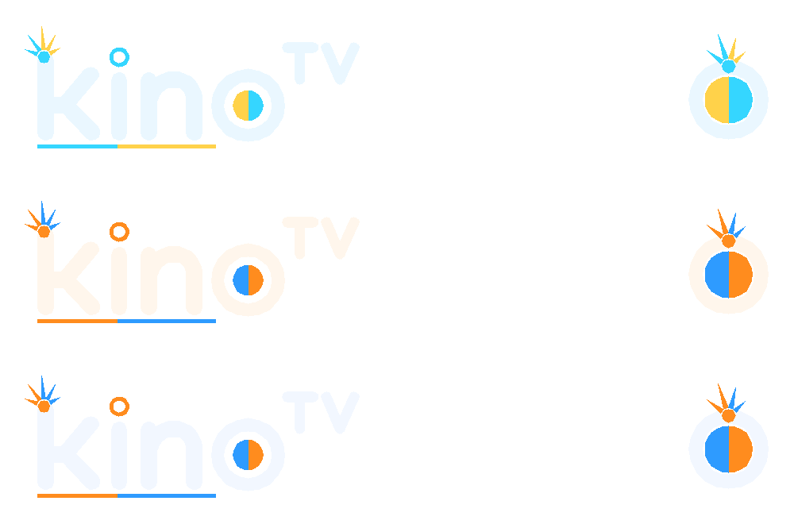

# Fusión Vegitto y Gogeta — temas de Kino

Plugin de **temas de la app** para [Kino](https://kinotvapp.github.io/kino-plugins/) (`appThemes`,
`apiVersion` 18, Kino 0.9.81 o posterior). No reproduce nada y no se conecta a internet: son datos,
`"hosts": []`, y no pide ninguna capacidad salvo `screen` para su pantalla de presentación.

| Tema (`id`) | Nombre | De dónde salen los colores |
| --- | --- | --- |
| `vegitto` | Vegitto Azul | Gi azul casi negro, pelo cian, faja naranja, guantes azul claro y aro Potara dorado |
| `gogeta` | Gogeta Fuego | Chaleco naranja, ropa clara, faja azul y botas doradas |
| `fusion` | Fusión V+G | Los dos a la vez: oro y cian con el azul de la faja |

## El logo

Cada tema trae el **logo real de Kino** —el wordmark `kino` con la `TV` y la marca de la `o`, con la
geometría de `app/src/main/java/app/kino/demo/ui/brand/KinoWordmark.kt` de
[kinotvapp/kino-light](https://github.com/kinotvapp/kino-light)— y solo cambian los detalles:

- las letras y el aro de la `o` siguen en el color del texto, como el logo original;
- un **mechón de pelo** pegado a la `k`: los mechones nacen dentro del trazo de la letra, así que la
  figura queda unida a ella y no flotando encima;
- la `i` lleva un **aro** (el aro Potara) en lugar del punto redondo;
- el punto de la `o` va **partido en dos colores** y la **barra bajo «kino»** también (izquierda un
  color, derecha el otro);
- la marca del TV (el riel cerrado) es la `o` con el círculo partido y el mechón encima.

Cada tema usa los colores de su personaje: Vegitto cian y oro Potara; Gogeta naranja y el azul de
la faja; Fusión naranja y azul, los dos a la vez.

`logo.paths` solo rellena trazos (no hay `stroke` en el contrato), así que los trazos de Kino
(grosor 42, extremos redondos) se convierten a contornos rellenos equivalentes. Kino conserva su
propio logo en la pantalla de inicio y en las pantallas de decisión, como manda el contrato.



## Instalar

En Kino: **Plugins ▸ Agregar un plugin** y pega la dirección de este repositorio. Después, **Ajustes ▸
Apariencia** para elegir el tema y **Personalizar** para cambiar el acento, el foco, las esquinas y el
tamaño del texto (solo lo que el tema marca como `adjustable`, con muestras para el control remoto).

La pantalla del plugin (**Fusión V+G** en el menú) presenta los tres temas y los activa con
`go.useTheme`, leyendo `activeTheme` para mostrar cuál está puesto.

## Comprobar

```
node sdk/validate.mjs .            # formato, rangos y protecciones de legibilidad, celular y TV
node sdk/run.mjs --context '{"activeTheme":"vegitto"}' . screen
node sdk/run.mjs . screenEvent open
```

El kit oficial del contrato (`sdk/` y `contract.json`, de `kinotvapp/kino-plugin-archive`) se copia
al lado para validar y no se versiona aquí. El generador de este manifiesto
(`tools/gen_manifest.py`) comprueba además los pares de contraste del contrato y los límites de cada
logo (8 trazos, 2.000 caracteres por trazo, lienzo de 1.000, hasta 8 veces más ancho que alto) y
vuelve a dibujar `preview-logos.png`.

## Archivos

- `kino-plugin.json` — el manifiesto (tope 16 KB): `appThemes` con los tres temas y sus logos.
- `plugin.js` — la pantalla de presentación (`screen` / `screenEvent`).
- `tools/gen_manifest.py` — genera el manifiesto y la vista previa.
- `preview-logos.png` — los tres logos, sin fondo.
